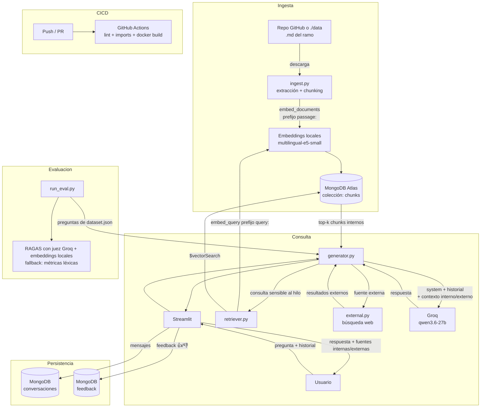

# Arquitectura — RAG DuocUC (Groq)

## Diagrama de flujo

## Decisiones y diferencias con la versión OpenAI

| Aspecto | Esta versión | Por qué |
|---------|--------------|---------|
| LLM | Groq (`qwen/qwen3.6-27b`), SDK oficial `groq` | Se dispone de key de Groq; se maneja el modo *reasoning* de qwen3. |
| Embeddings | Locales `multilingual-e5-small` (384 dims) | Groq no ofrece embeddings; local = sin key y sin costo por token. Multilingüe por el corpus en español. |
| Costo | Sólo generación (Groq); embeddings = $0 | Consecuencia directa de usar embeddings locales. |
| Índice Atlas | 384 dims (`config.EMBEDDING_DIM`) | Debe calzar con el modelo de embeddings; parametrizado, no hardcodeado. |
| Fuentes | Internas (PDFs en Mongo) + externa (búsqueda web, `external.py`) | La rúbrica pide integrar fuentes internas y externas; se etiqueta el origen para trazabilidad. |
| Contexto conversacional | Ventana de historial enviada al LLM + consulta de retrieval sensible al hilo | Permite resolver seguimientos y referencias entre turnos. |

## Ambientes

| Ambiente | Rama | Base de datos Mongo |
|----------|------|----------------------|
| `dev`  | `dev`  | `rag-duoc-groq-dev` |
| `qa`   | `qa`   | `rag-duoc-groq-qa`  |
| `main` | `main` | `rag-duoc-groq`     |

Cada ambiente usa su propia base dentro del mismo cluster de Atlas. Lo controla la variable `ENVIRONMENT`.

## Secretos

Local: archivo `.env` (ver `.env.example`), ignorado por git. CI/CD: GitHub Secrets inyectados como env vars en `ci.yml`. Nunca se commitean credenciales.
