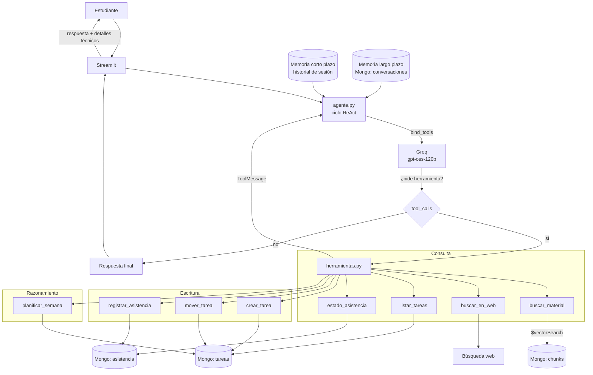

# Arquitectura — Asistente Organizador Académico (Agente, LangChain + Groq)

## 1. Orquestación del agente

El modelo recibe el prompt del sistema, la memoria y la pregunta, y **decide solo** qué herramientas llamar. Cada resultado vuelve al modelo, que puede pedir otra herramienta o cerrar con la respuesta final. El tope de vueltas lo fija `MAX_PASOS_AGENTE`.

## 2. Decisiones de diseño del agente

| Decisión | Por qué |
|---|---|
| Ciclo ReAct escrito a mano, no un grafo | ~30 líneas legibles y defendibles en la presentación, en vez de una abstracción que hay que creerle. El framework (LangChain) se usa donde aporta: `@tool` y `bind_tools`. |
| Modelo con function calling obligatorio | Los sistemas `compound` de Groq no aceptan herramientas propias. |
| Prioridad determinista en Python | `planificar_semana` no delega el criterio al LLM: es reproducible y testeable. |
| `TOP_K` 5 → 3 y `MAX_HISTORY_MSGS` 6 → 4 | Cada llamada del agente carga además el esquema de herramientas; el plan gratuito limita por minuto. |
| Memoria larga sobre `conversaciones` | La colección ya existía y se escribía, pero nadie la leía. |
| Tope de pasos del ciclo | Evita bucles infinitos de llamadas si el modelo se confunde. |

## 3. Matriz pauta EP2 → evidencia en el repositorio

| Criterio | Evidencia | Archivo |
|---|---|---|
| IE1 · Herramientas con autonomía | 8 herramientas (consulta, escritura, razonamiento) | `rag/herramientas.py` |
| IE2 · Framework de agentes | LangChain: `@tool` + `ChatGroq.bind_tools` | `rag/agente.py`, `requirements.txt` |
| IE3 · Memoria y continuidad | Corto plazo (`_memoria_corto_plazo`) y largo plazo (`obtener_memoria_larga`) | `rag/agente.py`, `rag/vectorstore.py` |
| IE4 · Recuperación semántica | `$vectorSearch` + embeddings E5, expuesto como herramienta | `rag/retriever.py`, `rag/herramientas.py` |
| IE5 · Planificación y prioridades | `planificar_semana`, criterio ponderación/días | `rag/herramientas.py` |
| IE6 · Informe con diagramas | Diagrama de orquestación y tabla de decisiones | este archivo |
| IE7 · Ejemplos de decisión | 10 casos funcionales con PASS/FAIL versionado | `evaluation/casos_agente.json`, `resultados_agente.json` |
| IE8 · Diagrama + README | Arquitectura del agente y guía de ejecución | este archivo, `README.md` |
| IE9 · Justificación de componentes | Tabla de decisiones de diseño | sección 2 de este archivo |

## 4. Diagrama de flujo del RAG (base heredada de la EP1)

## Decisiones y diferencias con la versión OpenAI

| Aspecto | Esta versión | Por qué |
|---------|--------------|---------|
| LLM | Groq (`groq/compound-mini`, configurable en `GROQ_MODEL`) | Modelo no-razonador que responde limpio y hace búsqueda web propia; los qwen3 truncaban en free tier. |
| Embeddings | Locales `multilingual-e5-small` (384 dims) | Groq no ofrece embeddings; local = sin key y sin costo por token. Multilingüe por el corpus en español. |
| Costo | Sólo generación (Groq); embeddings = $0 | Consecuencia directa de usar embeddings locales. |
| Índice Atlas | 384 dims (`config.EMBEDDING_DIM`) | Debe calzar con el modelo de embeddings; parametrizado, no hardcodeado. |
| Fuentes | Internas (PDFs en Mongo) + externa (búsqueda web, `external.py`) | La rúbrica pide integrar fuentes internas y externas; se etiqueta el origen para trazabilidad. |
| Contexto conversacional | Ventana de historial enviada al LLM + consulta de retrieval sensible al hilo | Permite resolver seguimientos y referencias entre turnos. |

## Ambientes

| Ambiente | Rama | Base de datos Mongo |
|----------|------|----------------------|
| `dev`  | `dev`  | `rag-duoc-groq-dev` |
| `qa`   | `qa`   | `rag-duoc-groq-qa`  |
| `main` | `main` | `rag-duoc-groq`     |

Cada ambiente usa su propia base dentro del mismo cluster de Atlas. Lo controla la variable `ENVIRONMENT`.

## Secretos

Local: archivo `.env` (ver `.env.example`), ignorado por git. CI/CD: GitHub Secrets inyectados como env vars en `ci.yml`. Nunca se commitean credenciales.

## Herramientas académicas

La UI (Streamlit) suma un panel de herramientas (componente HTML/JS, estado en `localStorage`): clases del día, calendario, calculadora de notas, asistencia, Pomodoro, adjuntar PDF → resumen, notas arrastrables y tablero Kanban de trabajos grupales.
