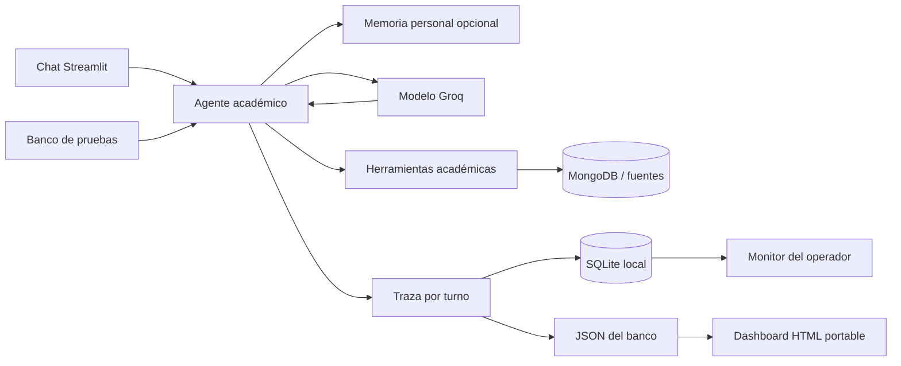

# Bocetos de diseño de la observabilidad

## Del turno a la evidencia



El banco sustituye Groq por un modelo guionizado y MongoDB por una colección en memoria para cada repetición. La modalidad `--groq` conserva los datos ficticios y cambia solo el proveedor del modelo. El chat y el monitor operativo se ejecutan en procesos separados.

## Distribución del monitor

```text
[ Origen ]          [ Escenario ]        [ Estado del turno ]
Precisión     Consistencia     Incidencias      Latencia
CPU           Tokens           Modelo          Herramientas
[ P95 por escenario     ]      [ Tiempo por etapa e incidencias ]
[ Selector de turno: escenario, estado e identificador         ]
[ Paso | Etapa | Herramienta | Inicio | Duración | Estado       ]
```

Para la defensa se puede abrir el archivo HTML directamente. En la aplicación del operador, «Actualizar trazas locales» vuelve a leer SQLite. Los campos sin observaciones elegibles se muestran como «s/d».
